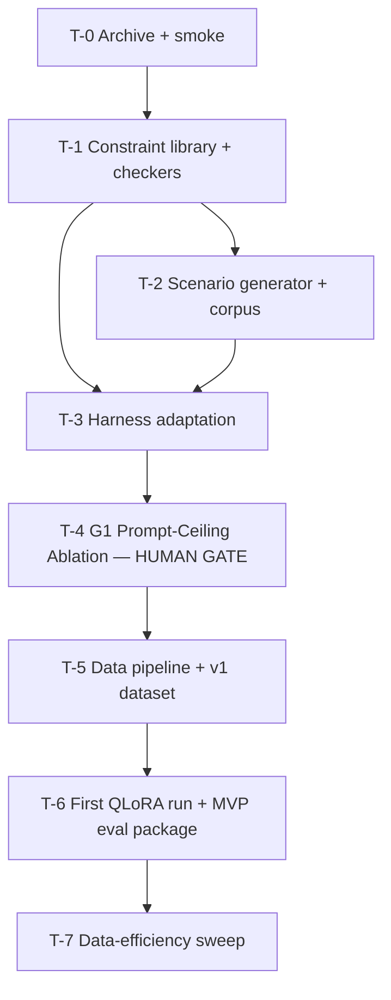

# Forbidden-Constraint Holder Pivot — Task Graph

> **Path convention (corrected 2026-08-20).** The tickets as originally written targeted a
> `src/**` + `results/**` layout from a harness scaffold that is not used here. All Scope and
> Verify lines below have been rewritten to this repo's native format: top-level packages
> (`datagen/`, `training/`, `constraints/`, `scenarios/`), flat `tests/test_*.py`, JSON configs
> in `configs/`, run artifacts in `runs/`, checkers in `scripts/`. Note `tests/test_checkers.py`
> is already taken by the abstainer phase-checker suite, so T-1's tests are
> `tests/test_constraints.py`.

## Dependency graph

## Tickets

### T-0: Abstainer state archived; existing harness still green
- **Objective**: Preserve the abstainer build for the Brainlift narrative (and the parallel-hedge option) and confirm the carried-over harness runs before anything is modified.
- **Refs**: Spec §Current behavior, §Non-goals
- **Acceptance**: 1. Abstainer scenarios, checks, and ablation results moved to `archive/abstainer/` untouched. 2. Pivot work on a new branch. 3. Existing eval.py smoke run passes on an archived abstainer mini-set.
- **Verify**: `python eval.py --model <base> --eval-set archive/abstainer/smoke.jsonl` exits 0 and writes a transcript JSONL
- **Scope**: `archive/**`, branch setup; no source edits
- **Depends on**: none
- **Non-goals**: deleting anything; modifying eval.py

### T-1: Constraint library + deterministic checkers (HUMAN GATE: fixture sign-off)
- **Objective**: The ground-truth layer everything else trusts — a registry of ≥5 constraint types across ≥3 families, each with a pure deterministic checker.
- **Refs**: R1, Design §Interfaces/Constraint, §Interfaces/Checker
- **Acceptance**: 1. Registry with ≥5 types spanning lexical, character, structural, format-negative families. 2. Every checker passes the golden-fixture suite. 3. Golden fixtures (~30 labeled pass/fail cases including tricky near-misses: banned word inside a larger word, punctuation in quoted text, unicode variants) are approved by Hank before this ticket closes — approval is a step in this ticket, not an assumption.
- **Verify**: `pytest tests/test_constraints.py -q`
- **Scope**: `constraints/**`, `tests/test_constraints.py`, `data/fixtures/checker_golden.jsonl`
- **Depends on**: T-0
- **Non-goals**: length/count constraints; any checker requiring a model call

### T-2: Scenario generator + scenario corpus with type split
- **Objective**: Produce the eval scenario corpus: tasks × composed constraint sets (k=2–4, ≥1 negative) × pressure levels, with the constraint-type train/heldout split enforced.
- **Refs**: R2, R3, Design §Interfaces/Scenario
- **Acceptance**: 1. ≥120 scenarios (≥30 per ablation cell after sampling), ≥40% pressure=adversarial with distractor topics that elicit banned tokens. 2. Schema-valid against Design §Interfaces. 3. Type-split invariant test passes: no heldout_type constraint in any train-split scenario. 4. k distribution covers 2, 3, and 4.
- **Verify**: `pytest tests/test_scenarios.py -q`
- **Scope**: `scenarios/**`, `tests/test_scenarios.py`, `data/scenarios/**`
- **Depends on**: T-1
- **Non-goals**: dataset (training-data) generation — that is T-5

### T-3: Harness adaptation (checks, judge rubric, metrics)
- **Objective**: eval.py scores the new behavior: constraint checkers as the behavioral check, task-quality judge (1–5) as the anti-reward-hacking gate, Spec-adherence and Robustness computed per Design §Metrics, transcripts in the extended JSONL format.
- **Refs**: R4, R5, R9, Design §Interfaces/Transcript, §Verification strategy
- **Acceptance**: 1. `eval.py --model <m> --eval-set <path>` produces the results table + transcript JSONL on a 5-scenario smoke set. 2. spec_pass logic = all checkers pass AND quality ≥3; judge output never overrides a checker. 3. Ablation mode runs model×strategy over the corpus with existing throttling. 4. Base-vs-tuned comparison mode intact.
- **Verify**: `pytest tests/test_harness.py -q && python eval.py --model <base> --eval-set data/scenarios/smoke.jsonl`
- **Scope**: `eval.py`, `judge.py`, `tests/test_harness.py`
- **Depends on**: T-1, T-2
- **Non-goals**: changing the CLI contract; any training code

### T-4: G1 Prompt-Ceiling Ablation (HUMAN GATE: results to Hank before T-5)
- **Objective**: Empirically establish the prompt ceiling for the new target before any pipeline investment — the ticket this pivot exists to get right.
- **Refs**: R6, S1
- **Acceptance**: 1. ≥2 frontier models from different families × zero-shot / few-shot / structured-CoT × ≥30 scenarios per cell, scored by the T-3 harness. 2. Results table: mean Spec-adherence + Robustness per cell, plus the surviving-failure-mode paragraph. 3. Gate script evaluates R6 thresholds; on a clean row, execute the escalation ladder (k↑, then adversarial share↑) and rerun before concluding. 4. Full table + gate verdict + raw transcripts delivered to Hank; T-5 does not start without his go.
- **Verify**: `python run_ablation.py --config configs/g1.json && python scripts/gate_check.py runs/g1/g1_table.json`
- **Scope**: `run_ablation.py`, `configs/g1.json`, `scripts/gate_check.py`, `runs/g1/**`
- **Depends on**: T-3
- **Non-goals**: any data generation or training; softening thresholds without Hank's sign-off

### T-5: Teacher-distillation pipeline + v1 dataset
- **Objective**: Generate and publish-ready-filter the v1 training dataset: teacher completions under sampled train-split constraint sets, rejection-filtered through the T-1 checkers.
- **Refs**: R7, R3
- **Acceptance**: 1. Every stored example passes all its checkers (enforced at write time; re-verified by test). 2. Wide constraint sampling across train-split types (no type >25% of examples). 3. Rejected-but-fluent violations retained separately as candidate DPO negatives. 4. ≥4,096 clean examples (covers the largest N in R8).
- **Verify**: `pytest tests/test_datagen.py -q`
- **Scope**: `datagen/**`, `tests/test_datagen.py`, `data/train/**`
- **Depends on**: T-4 (gate passed)
- **Non-goals**: training; touching heldout_type constraints

### T-6: First QLoRA run + MVP eval package
- **Objective**: Close the loop: train on v1, produce the first base-vs-tuned numbers in the PDF's verification format.
- **Refs**: R8 (first point), R9, S2, S3
- **Acceptance**: 1. QLoRA run on Qwen3-1.7B Instruct completes; checkpoint pushed to HF (public) with commit hash recorded. 2. eval.py base-vs-tuned on both splits (train-types eval + heldout-types eval) with raw transcripts. 3. Versions pinned: model hash + eval-code hash in the results manifest. 4. Smoke-verified live-demo script (grader-suppliable prompt → base and tuned side by side).
- **Verify**: `python eval.py --model <hf-repo-id> --eval-set data/scenarios/eval.jsonl && python eval.py --model <base> --eval-set data/scenarios/eval.jsonl`
- **Scope**: `training/**`, `runs/mvp/**`, `scripts/demo.py`
- **Depends on**: T-5
- **Non-goals**: hyperparameter iteration; data v2 (that's the Early-Submission failure-mode loop, planned after MVP numbers exist)

### T-7: Data-efficiency sweep
- **Objective**: Train checkpoints at N = 64 / 256 / 1024 / 4096 subsets of v1 and produce the performance-vs-N curve for Spec-adherence and Robustness.
- **Refs**: R8, S4
- **Acceptance**: 1. Four checkpoints, same config, differing only in N. 2. All evaluated on the identical eval set via eval.py. 3. Curve artifact + training logs sufficient for a grader to rerun one point. 4. Candidate minimum-viable-N stated with justification.
- **Verify**: `python eval.py --model <hf-repo-id-N64> --eval-set data/scenarios/eval.jsonl` (spot-check per checkpoint) 
- **Scope**: `training/**`, `runs/efficiency/**`
- **Depends on**: T-6
- **Non-goals**: new rubric or eval-set edits mid-sweep
